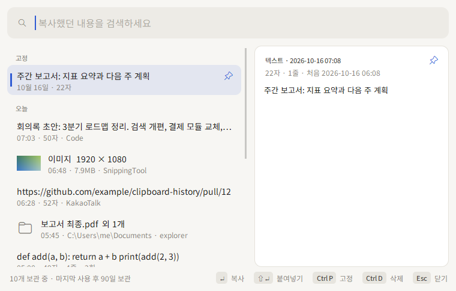
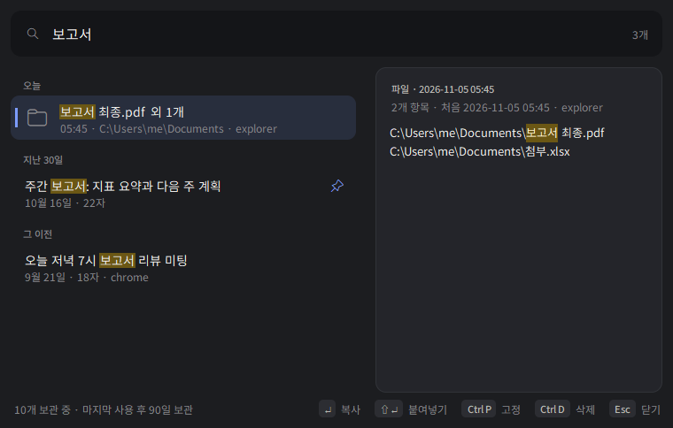
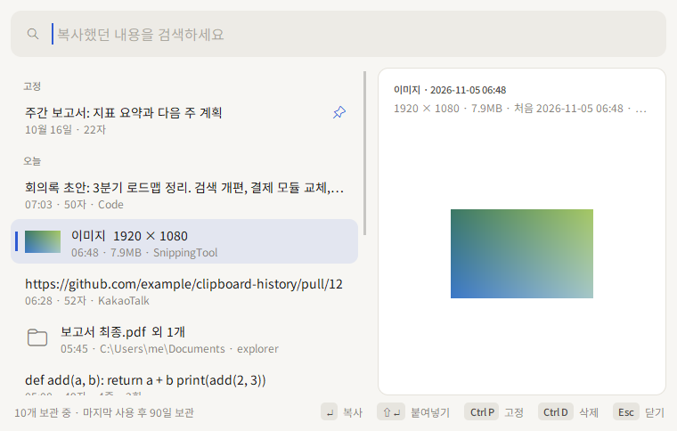

<p align="center"></p>

<h1 align="center">clipboard-history</h1>

<p align="center">
Windows 클립보드, 25개에서 끝나지 않게.<br>
A Windows clipboard history that doesn't forget after 25 items.
</p>

<p align="center"><a href="#english">English below</a></p>

---

## 왜 만들었냐면

열 줄 가까이 공들여 쓴 메시지가 전송 버튼을 누르는 순간 날아갔습니다. 그래도 복사해 뒀으니 Win+V로 꺼내면 되겠다 싶었는데, Windows 클립보드 기록은 **25개까지만** 남고, 재부팅하면 고정한 것 말고는 **다 사라집니다**. 이미 밀려나 있었어요.

그래서 만들었습니다. 복사한 건 다 남기고, 나중에 검색해서 다시 꺼내 쓰는 작은 상주 프로그램입니다.



## 뭘 해 주냐면

- **복사한 건 다 기록합니다.** 텍스트, 서식(HTML/RTF), 이미지, 탐색기에서 복사한 파일까지 Win+V가 다루는 것은 다 남깁니다. 개수 제한은 없고, 마지막으로 쓴 지 **90일**이 지나면 알아서 정리합니다(고정한 건 빼고).
- **Win+Alt+V로 바로 검색합니다.** 글자를 치면 바로 걸러지고 Enter 한 번이면 다시 클립보드에 들어갑니다. 검색어는 형광펜처럼 칠해지고, 결과는 오늘 / 어제 / 지난 7일처럼 시간대별로 묶여서 "그때 그거"를 찾기 쉽습니다.
- **원본 그대로 돌려줍니다.** 서식 있는 글은 서식째, 이미지는 이미지로, 파일은 다시 붙여넣을 수 있는 파일로 돌려줍니다.
- **내 PC 밖으로 안 나갑니다.** 네트워크 기능이 아예 없습니다. 저장할 때는 Windows 계정 키(DPAPI)로 암호화해서, DB 파일만 빼 가서는 읽을 수 없습니다.
- **비밀번호는 피해 갑니다.** 비밀번호 관리자가 "기록하지 마" 표시를 붙여 복사한 것과, 제외 목록에 넣은 앱이 복사한 것은 아예 읽지도 않습니다. 다만 브라우저 확장형 관리자처럼 표시를 안 붙이는 경우는 기록될 수 있으니, 필요하면 잠깐 일시정지하세요.
- **설치할 게 없습니다.** Python 표준 라이브러리만 씁니다(pip install 없음).

| 다크 모드 + 검색 | 이미지 미리보기 |
|---|---|
|  |  |

## 설치

Python 3.10 이상이 필요합니다. PowerShell에서 실행하세요(관리자 권한은 필요 없음).

```powershell
git clone https://github.com/moonjoungyoung/clipboard-history.git
cd clipboard-history
powershell -ExecutionPolicy Bypass -File .\scripts\install.ps1
```

끝입니다. 로그온할 때 자동으로 켜지고, 트레이에 아이콘이 생깁니다. (PowerShell 스크립트 실행을 이미 허용해 뒀다면 `.\scripts\install.ps1`만 쳐도 됩니다.)

### Win+V를 아예 이걸로 바꾸고 싶다면

```powershell
.\scripts\use-win-v.ps1         # 이제 Win+V를 누르면 이 창이 뜹니다
.\scripts\use-win-v.ps1 -Undo   # 원래대로
```

Windows 탐색기가 Win+V를 쥐고 있어서, 탐색기 설정(`DisabledHotkeys`)에서 V를 끄고 탐색기를 한 번 다시 시작합니다. 작업 표시줄이 잠깐 깜빡이고 열려 있던 파일 탐색기 창은 닫힙니다(다른 프로그램 창은 그대로).

## 쓰는 법

| 하고 싶은 것 | 이렇게 |
|---|---|
| 검색 창 열기 | **Win+Alt+V**(위 설정을 했다면 Win+V), 또는 트레이 아이콘 클릭 |
| 다시 복사 | **Enter** 또는 더블클릭 |
| 복사하고 바로 붙여넣기 | **Shift+Enter**(단축키로 창을 열었을 때, 원래 쓰던 창에 붙여넣음) |
| 고정 / 해제 | **Ctrl+P**(고정한 건 90일이 지나도 안 지워짐) |
| 삭제 | **Ctrl+D** 또는 오른쪽 클릭 |
| 닫기 | **Esc**(검색어가 있으면 먼저 지움), 또는 다른 곳 클릭 |
| 잠깐 기록 멈추기 | 트레이 오른쪽 클릭 → 기록 일시정지 |

## 설정

`%LOCALAPPDATA%\ClipboardHistory\config.json`을 고치고 프로그램을 다시 시작하면 됩니다.

```json
{
  "retention_days": 90,
  "hotkey": "win+alt+v",
  "max_chars": 1000000,
  "max_bytes": 67108864,
  "recent_menu_count": 15,
  "exclude_processes": ["KeePass.exe", "KeePassXC.exe", "1Password.exe", "Bitwarden.exe", "Enpass.exe"],
  "exclude_patterns": []
}
```

- `exclude_processes`: 이 프로그램들이 복사한 건 저장하지 않습니다.
- `exclude_patterns`: 정규식에 맞는 텍스트는 저장하지 않습니다(앞뒤 공백·줄바꿈을 뗀 상태로도 한 번 더 검사). 토큰을 거르고 싶다면 `"^sk-[A-Za-z0-9_-]{20,}$"`, `"^gh[pousr]_[A-Za-z0-9]{20,}$"`, `"^AKIA[0-9A-Z]{16}$"` 같은 걸 넣으세요.
- `max_bytes`: 이미지나 서식 하나가 이보다 크면 건너뜁니다(기본 64MB).
- 값의 형식이 틀리면 그 항목만 기본값으로 돌아가고 트레이 알림으로 알려 줍니다. 파일 자체가 JSON으로 안 읽히면 전체가 기본값이 됩니다.

## 데이터는 어디에

`%LOCALAPPDATA%\ClipboardHistory\`

- `history.db`: SQLite. 내용, 서식, 이미지, 썸네일 모두 DPAPI로 암호화한 상태로 들어 있습니다. 복사한 앱 이름, 시각, 글자 수, 이미지 크기 같은 부가 정보는 암호화하지 않습니다.
- `key.bin`: 같은 내용을 다시 복사했는지 알아보는 데 쓰는 키입니다(이것도 암호화되어 있음).
- `app.log`: 동작 로그입니다. id, 글자 수, 건너뛴 이유만 남기고 **내용은 남기지 않습니다**.

같은 Windows 계정에서만 열 수 있습니다. 관리자가 비밀번호를 강제로 재설정하는 등의 이유로 계정 키가 바뀌면 예전 기록은 열 수 없게 됩니다. 이때는 예전 파일을 지우지 않고 `*.broken-날짜`로 옮겨 둔 뒤 새로 시작합니다(파일이 잠깐 잠겨 있는 것 같은 일시적인 문제로는 옮기지 않습니다).

## 지우기

```powershell
.\scripts\uninstall.ps1              # 끄고 자동 실행 해제(기록은 남김, Win+V도 원래대로)
.\scripts\uninstall.ps1 -RemoveData  # 기록까지 전부 삭제
```

## 명령줄

```powershell
python -m clipboard_history stats          # 개수와 용량(내용은 안 보여 줌)
python -m clipboard_history search 단어     # 일치하는 항목 id
python -m clipboard_history copy 123       # 123번을 다시 복사
python -m clipboard_history pause|resume   # 기록 멈춤/재개
python -m clipboard_history open|quit      # 창 열기 / 종료
```

## 개발

```powershell
python -m unittest discover -s tests   # 단위 테스트(창은 안 띄움)
.\scripts\run-e2e.ps1                  # 실제 데스크톱 세션에서 하는 e2e(더미 데이터)
.\scripts\run-render.ps1               # 검색 창 스크린샷(더미 데이터)
```

e2e는 임시 폴더를 따로 쓰고, 도는 동안 실제로 실행 중인 인스턴스는 일시정지시킵니다(테스트가 중간에 죽어도 10분 뒤 자동 재개). 끝나면 원래 클립보드의 텍스트·서식·이미지·파일 목록을 되돌려 놓습니다. 비밀번호처럼 백업하면 안 되는 내용이 클립보드에 있으면 시작하지 않습니다.

```
clipboard_history/
  app.py      상주 본체(이벤트 처리, 보존 기간 정리)
  win32.py    클립보드 감시·읽기·쓰기, 단축키, 트레이, Win11 창 모양(ctypes)
  formats.py  형식 묶음, 이미지 썸네일, 파일 목록
  store.py    SQLite + DPAPI 저장소
  ui.py       검색 창(tkinter)
  theme.py    색과 크기(라이트 'paper' / 다크 'carbon')
```

## 알아 두면 좋은 것

- 검색할 때는 전체 기록을 복호화해서 메모리에 올려 둡니다. 텍스트 몇만 개 정도는 문제없습니다.
- 강제로 종료하면 트레이 아이콘이 잠깐 남을 수 있습니다(마우스를 올리면 사라짐).
- 미리보기는 앞 2만 자까지만 보여 줍니다. 다시 복사하면 전체가 들어갑니다.
- 관리자 권한으로 실행 중인 창에는 Shift+Enter 붙여넣기가 막힐 수 있습니다(Windows 보안 제한).

---

<a id="english"></a>

## English

### Why

I once lost a long message right as I hit send. "No problem, I copied it," I thought, and opened Win+V. But Windows only keeps the **last 25** clipboard items, and a reboot wipes everything that isn't pinned. It was already gone.

So I built this: a tiny tray app that keeps everything you copy and lets you search it later.

### What it does

- **Keeps everything you copy.** Text, rich text (HTML/RTF), images, and files copied in Explorer, the same things Win+V handles. No item limit. Entries are cleaned up **90 days** after you last used them (pinned ones stay).
- **Win+Alt+V to search.** Results filter as you type and Enter puts the item back on the clipboard. Matches get a highlighter mark, and results are grouped by Today / Yesterday / Last 7 days so "that thing from Tuesday" is easy to find.
- **Gives it back exactly.** Formatting stays formatting, images stay images, files paste as files.
- **Stays on your PC.** There is no network code at all. Everything is encrypted with your Windows account key (DPAPI), so the database file alone is unreadable.
- **Steers clear of passwords.** Copies that password managers mark as "don't record", and copies from apps on your exclude list, are never read. Browser-extension managers that don't set the marker can still get recorded, so pause recording from the tray when you need to.
- **Nothing to install.** Python standard library only, no pip.

### Install

Python 3.10+, then in PowerShell (no admin needed):

```powershell
git clone https://github.com/moonjoungyoung/clipboard-history.git
cd clipboard-history
powershell -ExecutionPolicy Bypass -File .\scripts\install.ps1
```

It starts at logon and lives in the tray.

**Want it on Win+V instead of the built-in panel?** Run `.\scripts\use-win-v.ps1` (undo with `-Undo`). It turns off Explorer's Win+V via `DisabledHotkeys` and restarts Explorer once (the taskbar blinks and open File Explorer windows close; other apps are untouched).

### Keys

| | |
|---|---|
| Open | **Win+Alt+V** (or Win+V after `use-win-v.ps1`), or click the tray icon |
| Copy back | **Enter** or double-click |
| Copy and paste into the previous window | **Shift+Enter** |
| Pin / unpin | **Ctrl+P** |
| Delete | **Ctrl+D** or right-click |
| Close | **Esc** or click elsewhere |

### Config, data, uninstall

- Config: `%LOCALAPPDATA%\ClipboardHistory\config.json` (retention days, hotkey, excluded apps, regex filters, size limits).
- Data: `%LOCALAPPDATA%\ClipboardHistory\history.db`. Contents, formats, images and thumbnails are encrypted with DPAPI; metadata (source app, time, size) is not. The log never contains clipboard contents.
- Uninstall: `.\scripts\uninstall.ps1` (add `-RemoveData` to delete the history too).

### Development

`python -m unittest discover -s tests` for unit tests, `.\scripts\run-e2e.ps1` for an end-to-end run in your real desktop session (dummy data, the running instance is paused meanwhile), `.\scripts\run-render.ps1` for UI screenshots.

## License

MIT
